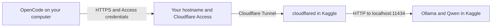

# Kaggle LLM Scripts

Small, versioned setup scripts for model experiments in Kaggle notebooks. Run Qwen with Ollama on a Kaggle GPU, then use it from OpenCode on your own computer through an authenticated Cloudflare Tunnel.

<details>
<summary><strong>Set up with an AI agent (Codex, Claude Code, or OpenCode)</strong></summary>

## Set up with an AI agent

Copy this into Codex, Claude Code, OpenCode, or another coding agent with local file and network access:

```text
Help me set up Kaggle Qwen for OpenCode using this guide:
https://raw.githubusercontent.com/0xnbk/kaggle-llm-scripts/refs/heads/main/README.md
Read the complete README, including collapsed sections. Inspect my OS,
OpenCode version, and existing configuration before making changes.
Reuse existing setup, preserve unrelated settings, and ask only for missing
information. Guide me through any Cloudflare or Kaggle dashboard steps
that you cannot perform. Keep my domain private in generated public files.
Load credentials from a secure store; never request secrets in chat or put
credentials in source files, command history, or logs. Verify the model
list, streamed inference, and OpenCode QWEN_OK check. Report what passed
and any remaining manual steps, then give me the command for daily use.
```

### Launch Codex or Claude Code with the setup request

Use one of these commands with an already installed and signed-in agent. Each starts an interactive session with a setup request; it asks that agent to configure **OpenCode** using the instructions above.

**Codex**

```bash
codex "Read https://raw.githubusercontent.com/0xnbk/kaggle-llm-scripts/refs/heads/main/README.md and follow its 'Set up with an AI agent' instructions to help me configure Kaggle Qwen for OpenCode."
```

**Claude Code**

```bash
claude "Read https://raw.githubusercontent.com/0xnbk/kaggle-llm-scripts/refs/heads/main/README.md and follow its 'Set up with an AI agent' instructions to help me configure Kaggle Qwen for OpenCode."
```

These commands use the agent's existing model and permissions to help with setup. They do not configure Codex or Claude Code to run Qwen. Cloudflare and Kaggle actions still depend on the access available to that agent. If it cannot fetch the URL, provide the raw README text directly.

Command syntax: [official Codex CLI reference](https://learn.chatgpt.com/docs/cli/reference) and [Claude Code CLI reference](https://code.claude.com/docs/en/cli-reference).

</details>

## Available script

| Script | What it does |
| --- | --- |
| [`kaggle-qwen-boot.sh`](scripts/kaggle/kaggle-qwen-boot.sh) | Checks for an NVIDIA GPU, installs Ollama if needed, reuses or downloads Qwen, starts Ollama, and checks for `QWEN_OK`. It streams setup progress and model output into the notebook. If `CF_TUNNEL_TOKEN` is available, it also connects an existing Cloudflare Tunnel. |

**Already set up?** Start your Kaggle session, run the script in [Step 5](#5-start-qwen-in-kaggle), then follow [Use OpenCode](#8-use-opencode-for-your-project). For a new setup, follow the steps below in order.

## Contents

- [How the connection works](#how-the-connection-works)
- [Known working settings](#known-working-settings)
- [Step-by-step setup](#step-by-step-setup)
- [Troubleshooting](#troubleshooting)
- [Run a versioned release](#run-a-versioned-release)
- [Release process](#release-process)

## How the connection works



OpenCode reads your project, edits files, and runs commands on **your computer**. It sends prompts, selected file contents, and tool results to **Qwen in Kaggle** for inference. The project does not need to be uploaded to the notebook as a checkout, but the content sent to the model leaves your computer.

### Why a custom domain is used

This guide uses a **named, remotely managed Cloudflare Tunnel** with a stable hostname such as `llm.example.com`:

- The hostname gives OpenCode a fixed HTTPS API address, even when Kaggle starts a new session.
- Cloudflare Access protects that hostname and checks your client's credentials before forwarding requests.
- `cloudflared` connects outward from Kaggle. You do not need a public Kaggle IP address or an inbound port.

Use a subdomain of a domain you control and have active in Cloudflare. You can reuse an existing domain; a separate domain purchase is unnecessary. A subdomain such as `llm.example.com` can be dedicated to this API without replacing your main website.

**A custom domain is needed for the setup documented here, not for running Qwen inside the notebook.** Cloudflare also offers temporary Quick Tunnels with random `trycloudflare.com` addresses, but those are a different setup and [do not support Server-Sent Events](https://developers.cloudflare.com/tunnel/get-started/quick-tunnels/), which this guide uses for streamed model output.

### Addresses and the forwarded Host header

| Setting | Example | Where it belongs |
| --- | --- | --- |
| Public hostname | `llm.example.com` | Cloudflare DNS, the tunnel's published route, and the Access application. |
| Public API base URL | `https://llm.example.com/v1` | OpenCode and client-side API checks. Include `/v1`. |
| Local service URL | `http://localhost:11434` | The tunnel route. This reaches Ollama inside the same Kaggle session as `cloudflared`. |
| HTTP Host Header | `localhost:11434` | The tunnel route's additional HTTP settings. This is the Host header forwarded to Ollama. |

The local service URL uses HTTP because that connection stays inside the Kaggle environment. Your computer connects to the public hostname using HTTPS, and the tunnel connection is encrypted separately.

**The HTTP Host Header setting is required for this loopback-only Ollama setup.** Ollama listens on `127.0.0.1:11434`. If the tunnel forwards the public hostname as the Host header, Ollama can return an empty `403 Forbidden` even after Cloudflare Access accepts your credentials. Setting the forwarded Host header to `localhost:11434` resolves that mismatch. See [Ollama's proxy and tunnel guidance](https://docs.ollama.com/faq#how-can-i-use-ollama-with-cloudflare-tunnel) and [Cloudflare's HTTP Host Header setting](https://developers.cloudflare.com/cloudflare-one/networks/connectors/cloudflare-tunnel/configure-tunnels/origin-parameters/#httphostheader).

### Keep the credentials separate

| Credential | What it authorizes | Where to store it |
| --- | --- | --- |
| Cloudflare Tunnel token | Lets `cloudflared` connect the named tunnel to Cloudflare. | Kaggle Secret named `CF_TUNNEL_TOKEN`. |
| Access Client ID and Client Secret | Let OpenCode or `curl` pass the Access policy protecting the API. | A secure store on your computer; load them as `CF_ACCESS_CLIENT_ID` and `CF_ACCESS_CLIENT_SECRET`. |
| Cloudflare management API token | Lets an administrator change Cloudflare configuration, according to its permissions. | Only needed if you choose to administer Cloudflare through its API. The notebook and OpenCode do not need it. |

The tunnel token cannot authenticate OpenCode requests. The Access credentials cannot start the tunnel. Keep credentials out of source files, commits, notebook output, and shared logs. Access cookies such as `CF_Authorization` are credentials too.

## Known working settings

The model and runtime settings below returned `QWEN_OK` through OpenCode on **2026-11-10**, after the HTTP Host Header correction. Public hostname values are examples; use your own domain.

| Setting | Example or tested value |
| --- | --- |
| Public hostname | `llm.example.com` |
| OpenCode API base URL | `https://llm.example.com/v1` |
| Tunnel service URL | `http://localhost:11434` |
| Tunnel HTTP Host Header | `localhost:11434` |
| Access application | Self-hosted application covering `llm.example.com` and all its API paths. |
| Access policy | **Service Auth**, including the client's service token. |
| Ollama bind address | `127.0.0.1:11434` |
| Model | `qwen3-coder:30b` |
| Ollama context length | `32768` tokens, as reported by `ollama ps`. |
| GPU configuration | Two Tesla T4 GPUs; Ollama reported `100% GPU`. |
| OpenCode version | `1.19.5` |
| OpenCode model reference | `kaggle-qwen/qwen3-coder:30b` |
| macOS credential store | Keychain service `kaggle-qwen-cloudflare`, with accounts `CF_ACCESS_CLIENT_ID` and `CF_ACCESS_CLIENT_SECRET`. |

All public API hostnames in the examples use `example.com`. Configure your own hostname in Cloudflare and your local client; this repository does not provide a shared inference endpoint.

The successful one-prompt check proves the client-to-model connection. It does not prove repository-scale coding, tool use, or long-session reliability.

## Step-by-step setup

Expand one step at a time. Start at Step 1 for a new setup, or open the step you need.

<details>
<summary><strong>1. Choose your hostname</strong></summary>

### 1. Choose your hostname

1. Sign in to Cloudflare and confirm that your domain is active in your account.
2. Choose a dedicated hostname, for example `llm.example.com`.
3. Use that exact hostname for the Access application, tunnel route, and OpenCode API base URL throughout this guide.

The hostname and route are configured **in Cloudflare**. The Kaggle script does not create DNS records, choose a hostname, or need an `OLLAMA_PUBLIC_URL` variable. It only connects the tunnel using its token. See the [Cloudflare Tunnel setup guide](https://developers.cloudflare.com/tunnel/get-started/).

</details>

<details>
<summary><strong>2. Create client credentials and protect the hostname</strong></summary>

### 2. Create client credentials and protect the hostname

Set up Access before publishing the route so the API has an authentication policy from the start.

1. Open **Zero Trust → Access controls → Service credentials → Service Tokens**.
2. Select **Create Service Token**, give it a recognizable name, and choose its duration.
3. Save its **Client ID** and **Client Secret** in your computer's secure store. Cloudflare shows the secret only when it is generated. Step 6 includes a macOS Keychain example.
4. Open **Zero Trust → Access controls → Applications** and add a **Self-hosted** application.
5. Set its public hostname to `llm.example.com`. Leave the path unrestricted so the application covers `/v1/*` and `/api/*`.
6. Add an Access policy with action **Service Auth**. Add an **Include → Service Token** rule and select the token you just created.
7. Save the policy and application. Keep this API restricted to the intended service token.

OpenCode sends the Client ID and Client Secret in the `CF-Access-Client-Id` and `CF-Access-Client-Secret` request headers. A browser login alone does not supply these headers to OpenCode. See [Cloudflare Access service tokens](https://developers.cloudflare.com/cloudflare-one/access-controls/service-credentials/service-tokens/).

</details>

<details>
<summary><strong>3. Create or reuse a named tunnel</strong></summary>

### 3. Create or reuse a named tunnel

1. In Cloudflare, open **Networking → Tunnels**.
2. Create a tunnel, choose **cloudflared**, and give it a recognizable name. Use a **remotely managed** tunnel for this guide.
3. Copy the generated **tunnel token**. If Cloudflare shows an installation command, copy only the token value for the Kaggle secret.

If you already have the intended tunnel, reuse it and retrieve its current connector token. The script installs and runs `cloudflared` inside Kaggle; you do not need to run Cloudflare's system-service installation command in the notebook.

</details>

<details>
<summary><strong>4. Publish the route and set the HTTP Host Header</strong></summary>

### 4. Publish the route and set the HTTP Host Header

1. Open your tunnel and select **Routes → Add route → Published application**. For an existing route, select **Edit route**.
2. Enter your public hostname, `llm.example.com`.
3. Set **Service URL** to `http://localhost:11434`.
4. Expand **Additional application settings → HTTP settings**.
5. Set **HTTP Host Header** to **`localhost:11434`**. The configuration/API field for this setting is `httpHostHeader`.
6. Save the route. Confirm that Cloudflare has created the proxied DNS record for your hostname pointing to the named tunnel. If a conflicting DNS record already exists, inspect it before replacing anything.

Before moving on, check these values together:

| Cloudflare field | Value |
| --- | --- |
| Published hostname | `llm.example.com` |
| Service URL | `http://localhost:11434` |
| HTTP Host Header | `localhost:11434` |
| Access application hostname | `llm.example.com`, covering all paths. |
| Access policy action | **Service Auth** with your service token included. |

In DNS, the expected record is a **proxied CNAME** from your hostname to `<tunnel-id>.cfargotunnel.com`, using the ID of your named tunnel. Cloudflare normally creates this when you save the published route. `localhost:11434` belongs in the route's service and HTTP Host Header settings, not in the public DNS record.

The **public hostname stays your domain**. Only the Host header on the final request from `cloudflared` to Ollama becomes `localhost:11434`. This setting does not change your DNS name or OpenCode URL. Cloudflare stores it with the route; changing the route does not require downloading the model again. See [updating tunnel origin parameters](https://developers.cloudflare.com/cloudflare-one/networks/connectors/cloudflare-tunnel/configure-tunnels/origin-parameters/#update-origin-parameters).

</details>

<details>
<summary><strong>5. Start Qwen in Kaggle</strong></summary>

### 5. Start Qwen in Kaggle

1. Open your Kaggle notebook, select a GPU accelerator, and enable Internet access.
2. Enable file persistence if you want model files in `/kaggle/working/ollama_models` to carry over between sessions. Persistence does not keep processes running when the session ends.
3. Open **Add-ons → Secrets**, create **`CF_TUNNEL_TOKEN`**, and paste the tunnel token from Step 3. Grant the notebook access to this secret.
4. Run this in a notebook code cell:

```bash
!curl -fsSL https://raw.githubusercontent.com/0xnbk/kaggle-llm-scripts/refs/heads/main/scripts/kaggle/kaggle-qwen-boot.sh | bash
```

This quick start fetches the latest script from `main`. For a fixed version that you can review and checksum before execution, use [Run a versioned release](#run-a-versioned-release).

5. Wait for the local model response and tunnel status. The first model load can take several minutes. A successful run includes:

```text
QWEN_OK
Cloudflare Tunnel connected; hostname routing is configured in Cloudflare.
```

The script prints the streamed answer and then a separate success marker, so seeing `QWEN_OK` twice is expected. `Waiting for Qwen output...` is a progress heartbeat while inference is pending.

`QWEN_OK` here proves inference **inside Kaggle**. The tunnel message means the connector registered with Cloudflare; it does not verify your public DNS, Access policy, forwarded Host header, or OpenCode request. Verify those in Step 7.

Without `CF_TUNNEL_TOKEN`, the script still runs the local model check and skips the tunnel. Keep Access credentials on your computer; the notebook only needs the tunnel token.

</details>

<details>
<summary><strong>6. Configure OpenCode on your computer</strong></summary>

### 6. Configure OpenCode on your computer

Install OpenCode using its [official installation instructions](https://opencode.ai/docs/), then check your version:

```bash
opencode --version
```

The working setup above uses **OpenCode 1.19.5**. Its configuration uses `provider`, `npm`, and `options`. Newer OpenCode versions use `providers`, `package`, and `settings`; an alternative is included below. Use the format for your installed version.

#### Save the provider configuration

For OpenCode 1.x, add this provider to `~/.config/opencode/opencode.json`. Create the file if it does not exist; otherwise **merge the provider into your existing configuration** so other settings are preserved. Replace `llm.example.com` with your hostname.

```json
{
  "$schema": "https://opencode.ai/config.json",
  "provider": {
    "kaggle-qwen": {
      "npm": "@ai-sdk/openai-compatible",
      "name": "Kaggle Qwen (Cloudflare Access)",
      "options": {
        "baseURL": "https://llm.example.com/v1",
        "apiKey": "ollama",
        "headers": {
          "CF-Access-Client-Id": "{env:CF_ACCESS_CLIENT_ID}",
          "CF-Access-Client-Secret": "{env:CF_ACCESS_CLIENT_SECRET}"
        }
      },
      "models": {
        "qwen3-coder:30b": {
          "name": "Qwen3 Coder 30B",
          "limit": {
            "context": 32768,
            "output": 8192
          }
        }
      }
    }
  }
}
```

`apiKey: "ollama"` is a non-secret compatibility placeholder. Access authentication comes from the two Cloudflare headers. An OpenAI API key is not needed for this endpoint.

`kaggle-qwen` is the provider's local identifier. Combined with the exact model name, it produces the reference `kaggle-qwen/qwen3-coder:30b`. The configuration deliberately leaves your global default model unchanged; the commands below select this model explicitly.

#### Alternative configuration for OpenCode versions using providers/package/settings

This format follows the current [OpenCode provider documentation](https://opencode.ai/docs/providers/) and [V1 migration guide](https://opencode.ai/docs/migrate-v1/). It has not been runtime-tested in the OpenCode 1.19.5 setup above. Use it with a version that supports this schema, and run the same connectivity checks afterward.

```json
{
  "$schema": "https://opencode.ai/config.json",
  "providers": {
    "kaggle-qwen": {
      "package": "@opencode/ai/providers/openai-compatible",
      "name": "Kaggle Qwen (Cloudflare Access)",
      "settings": {
        "baseURL": "https://llm.example.com/v1",
        "apiKey": "ollama"
      },
      "headers": {
        "CF-Access-Client-Id": "{env:CF_ACCESS_CLIENT_ID}",
        "CF-Access-Client-Secret": "{env:CF_ACCESS_CLIENT_SECRET}"
      },
      "models": {
        "qwen3-coder:30b": {
          "name": "Qwen3 Coder 30B",
          "capabilities": {
            "tools": true,
            "input": ["text"],
            "output": ["text"]
          },
          "limit": {
            "context": 32768,
            "output": 8192
          }
        }
      }
    }
  }
}
```

#### Load the Access credentials

OpenCode substitutes `{env:CF_ACCESS_CLIENT_ID}` and `{env:CF_ACCESS_CLIENT_SECRET}` from its process environment. On any platform, load those variables from your secure store before starting OpenCode. Having credentials saved in a password manager alone does not make them available to the process.

On **macOS**, you can use Keychain. Save the two values once with the following commands. Each command prompts for its value because `-w` is the last argument; paste the Client ID at the first password prompt and the Client Secret at the second. Do not append a credential to either command.

```bash
security add-generic-password -U -s kaggle-qwen-cloudflare -a CF_ACCESS_CLIENT_ID -w
security add-generic-password -U -s kaggle-qwen-cloudflare -a CF_ACCESS_CLIENT_SECRET -w
```

If these items already exist for your working setup, reuse them. `-U` replaces an existing item's value, so only run the save commands when creating or intentionally updating credentials.

Load them into the Terminal session where you will run the checks and OpenCode:

```bash
export CF_ACCESS_CLIENT_ID="$(security find-generic-password -s kaggle-qwen-cloudflare -a CF_ACCESS_CLIENT_ID -w)"
export CF_ACCESS_CLIENT_SECRET="$(security find-generic-password -s kaggle-qwen-cloudflare -a CF_ACCESS_CLIENT_SECRET -w)"

: "${CF_ACCESS_CLIENT_ID:?Could not load the Access Client ID}"
: "${CF_ACCESS_CLIENT_SECRET:?Could not load the Access Client Secret}"
```

Keep the values out of shell history and avoid printing them. New Terminal sessions need the variables loaded again, or you can use the optional wrapper below. A desktop app launched outside Terminal does not automatically inherit this Terminal environment.

#### Optional macOS zsh wrapper: load Keychain credentials whenever you run opencode

Add this function to `~/.zshrc` if you do not already have an equivalent wrapper. Open a new Terminal window afterward. It uses the OpenCode executable on your `PATH`, passes the credentials only to that command, and forwards all command arguments without forcing a model.

```bash
opencode() {
  local qwen_client_id qwen_client_secret qwen_state_home
  qwen_client_id="$(security find-generic-password -s kaggle-qwen-cloudflare -a CF_ACCESS_CLIENT_ID -w 2>/dev/null)" || {
    echo 'Cloudflare Access client ID is missing from Keychain.' >&2
    return 1
  }
  qwen_client_secret="$(security find-generic-password -s kaggle-qwen-cloudflare -a CF_ACCESS_CLIENT_SECRET -w 2>/dev/null)" || {
    echo 'Cloudflare Access client secret is missing from Keychain.' >&2
    return 1
  }
  qwen_state_home="${XDG_STATE_HOME:-$HOME/.config/opencode/state}"
  mkdir -p "$qwen_state_home" || return 1
  env \
    CF_ACCESS_CLIENT_ID="$qwen_client_id" \
    CF_ACCESS_CLIENT_SECRET="$qwen_client_secret" \
    XDG_STATE_HOME="$qwen_state_home" \
    opencode "$@"
}
```

The tested Mac also needed a writable state directory because the default `~/.local/state/opencode` path returned `EACCES`. This wrapper uses `~/.config/opencode/state` as the state home unless `XDG_STATE_HOME` is already set. It does not require changing ownership of unrelated directories or running OpenCode with `sudo`.

The wrapper loads credentials for **OpenCode only**. Load the exported variables separately when using `curl` in Step 7.

</details>

<details>
<summary><strong>7. Verify the public API and OpenCode</strong></summary>

### 7. Verify the public API and OpenCode

Run these checks on your computer while the Kaggle session is running. Load your Access credentials as described above, then set your public API base URL:

```bash
export API_BASE='https://llm.example.com/v1'

: "${API_BASE:?Set your public API base URL}"
: "${CF_ACCESS_CLIENT_ID:?Load the Access Client ID}"
: "${CF_ACCESS_CLIENT_SECRET:?Load the Access Client Secret}"
```

#### Check the model list

```bash
curl --silent --show-error --fail-with-body --max-time 30 \
  -H "CF-Access-Client-Id: $CF_ACCESS_CLIENT_ID" \
  -H "CF-Access-Client-Secret: $CF_ACCESS_CLIENT_SECRET" \
  -H 'Authorization: Bearer ollama' \
  "$API_BASE/models"
```

Expect HTTP 200 and a JSON response whose `data` array includes `qwen3-coder:30b`. This proves the protected route can reach Ollama's model-list endpoint. It does not run inference.

#### Check streamed inference

```bash
curl --no-buffer --silent --show-error --fail-with-body --max-time 300 \
  -H "CF-Access-Client-Id: $CF_ACCESS_CLIENT_ID" \
  -H "CF-Access-Client-Secret: $CF_ACCESS_CLIENT_SECRET" \
  -H 'Authorization: Bearer ollama' \
  -H 'Content-Type: application/json' \
  --data-binary '{
    "model": "qwen3-coder:30b",
    "messages": [{"role": "user", "content": "Count from 1 to 5."}],
    "stream": true
  }' \
  --write-out '\nHTTP %{http_code}; content type: %{content_type}\n' \
  "$API_BASE/chat/completions"
```

Expect incremental `data:` events, a final `data: [DONE]`, and HTTP 200 with content type `text/event-stream`. The short prompt may finish quickly, so it is primarily a format and connectivity check. `--no-buffer` makes `curl` display events as they arrive; it does not change server buffering.

Ollama's `/v1/chat/completions` supports streaming when `stream` is `true`. Cloudflare Tunnel recognizes the SSE content type for streaming; no separate streaming switch is needed on this route. See [Ollama's OpenAI-compatible API](https://docs.ollama.com/api/openai-compatibility) and [Cloudflare's streaming troubleshooting](https://developers.cloudflare.com/tunnel/troubleshooting/). These commands avoid dumping response cookies; redact credentials and cookies before sharing any diagnostic output.

#### Check OpenCode

```bash
opencode models kaggle-qwen
```

Expect `kaggle-qwen/qwen3-coder:30b`. This checks that OpenCode loaded your provider configuration; a listed model alone does not prove the remote API works.

```bash
opencode run -m kaggle-qwen/qwen3-coder:30b \
  "Reply with exactly QWEN_OK. Do not use tools."
```

Expect `QWEN_OK` in OpenCode's response. This is the end-to-end inference check that passed for the known working setup.

</details>

<details>
<summary><strong>8. Use OpenCode for your project</strong></summary>

### 8. Use OpenCode for your project

Open Terminal in the project you want OpenCode to work on and launch an interactive session:

```bash
cd /path/to/your/project
opencode -m kaggle-qwen/qwen3-coder:30b
```

Type tasks normally, for example:

```text
Read this project and explain its structure. Do not change anything yet.
```

```text
Investigate why the login form fails. Explain the cause before editing.
```

```text
Fix the issue in src/example.ts. Preserve unrelated changes and run
the relevant checks afterward.
```

`opencode run ...` sends an individual prompt; `opencode -m ...` opens an ongoing conversation. You can also use `/models` inside OpenCode to select the configured model. Review requested permissions, inspect `git diff`, and run relevant checks before committing model-generated changes.

The tested server has a **32,768-token context window**, shared by instructions, tool definitions, file contents, conversation history, and output. Start with focused tasks and fresh sessions for separate work. [Ollama's current OpenCode guide](https://docs.ollama.com/integrations/opencode) calls for 64k or more for coding use; the 32k example here is only confirmed for the short connectivity check. Increasing the served context requires checking GPU memory and starting Ollama with the new setting. Editing OpenCode's `limit.context` alone does not increase Ollama's capacity. The script can reuse an already-running server, so changing `OLLAMA_CONTEXT_LENGTH` before rerunning it does not necessarily reconfigure that server.

</details>

<details>
<summary><strong>9. Resume later or stop the session</strong></summary>

### 9. Resume later or stop the session

For a later session:

1. Start the Kaggle GPU session and confirm Internet access and secret access.
2. Run the boot script again. It reuses model files when Ollama can see them; if the files were not preserved, it needs to download them again.
3. Keep the existing hostname, route, Access application, and client credentials. A new Kaggle session does not require recreating them.
4. Check `QWEN_OK` and the tunnel connection, then run the OpenCode smoke command if needed.
5. Launch OpenCode from your project directory.

Closing OpenCode does not stop Kaggle. Stop the Kaggle session when finished to release its GPU resources. When Kaggle ends the session, Ollama and `cloudflared` stop and the public endpoint becomes unavailable until a connector is running again. The script does not keep a GPU session alive or bypass Kaggle session limits.

</details>

## Troubleshooting

### Identify which part failed

| Symptom | What to check |
| --- | --- |
| Local `QWEN_OK`, but the public API fails | The local model works. Check public DNS, Access, the published route, and the HTTP Host Header; local inference does not test those. |
| `401`/`403` with an Access error page, or a redirect to login | Check both client headers, token validity, the exact Access hostname, and the **Service Auth** policy's included token. |
| Empty `403`, including after Access accepts credentials | Check **HTTP Host Header = `localhost:11434`** first. Ollama's loopback Host check can reject the public hostname. Do not assume every 403 means invalid Access credentials. |
| Cloudflare `1033`, often shown with HTTP 530 | No healthy connector is available for the named tunnel. Check that the Kaggle session and `cloudflared` are running with the correct tunnel token. |
| HTTP 502 | A connector may be reachable while the local origin is not. Check Ollama, port `11434`, and the route's service URL. |
| Hostname does not resolve | Confirm the domain is active and the published route's DNS record exists. |
| Model missing or a model-not-found response | Compare the client model ID with `ollama list` in Kaggle. The default ID includes the tag: `qwen3-coder:30b`. |
| OpenCode cannot find the provider, or rejects configuration fields | Check your OpenCode version and the configuration format in Step 6. Merge into the config used by that process, then restart OpenCode. |
| OpenCode works in one Terminal but fails in another or in a desktop app | Check which environment has the Access variables or Keychain wrapper loaded. |
| `EACCES` creating `~/.local/state/opencode` on macOS | Use a writable `XDG_STATE_HOME`, as in the optional wrapper. |
| Initial inference takes minutes or times out | Inspect Ollama's logs and GPU status; a cold model load can be slow. Increasing a client's timeout does not override Cloudflare's own proxy timeout limits. |
| Output arrives all at once | Confirm `/v1/chat/completions`, `stream: true`, `text/event-stream`, and a client that displays events incrementally. A very short answer may complete almost immediately. |

### Confirm the Ollama Host-header mismatch inside Kaggle

If local inference works but authenticated public requests return an empty 403, run this diagnostic in a **new Kaggle notebook cell**:

```bash
%%bash
curl --silent --show-error --max-time 10 --output /dev/null \
  --write-out 'Default local Host: %{http_code}\n' \
  http://127.0.0.1:11434/api/version

curl --silent --show-error --max-time 10 --output /dev/null \
  --write-out 'Public Host: %{http_code}\n' \
  -H 'Host: llm.example.com' \
  http://127.0.0.1:11434/api/version

curl --silent --show-error --max-time 10 --output /dev/null \
  --write-out 'Corrected local Host: %{http_code}\n' \
  -H 'Host: localhost:11434' \
  http://127.0.0.1:11434/api/version
```

Replace `llm.example.com` with your public hostname. Results of `200`, `403`, and `200` reproduce the Host-header restriction directly. Fix the tunnel's **HTTP Host Header** in Step 4, then retry from your computer. Keep Ollama bound to loopback and Access protection enabled.

### Inspect Kaggle logs

Run this in a Kaggle notebook cell:

```bash
%%bash
tail -n 40 /kaggle/working/ollama.log
tail -n 40 /kaggle/working/cloudflared.log
ollama list
ollama ps
nvidia-smi
```

The model pull log is `/kaggle/working/ollama-pull.log` when a download has run. A tunnel log may be absent if the tunnel was skipped. Inspect logs locally and remove credentials, cookies, and private request content before sharing excerpts.

## Kaggle policy note

Kaggle's [Terms of Use](https://www.kaggle.com/terms) limit use to personal, non-commercial purposes. Its [Acceptable Use Policy](https://www.kaggle.com/aup) prohibits resource abuse, including server farming. This script starts an inference server and can start a Cloudflare Tunnel; Kaggle has not clarified whether a private, self-only setup is allowed. **Check with Kaggle before using its GPU as a remotely reachable inference server.** This repository does not grant permission to use Kaggle resources or bypass its limits.

## Run a versioned release

Use a pinned release, review the script, and verify its checksum before running it. In a Kaggle notebook, use a `%%bash` cell and replace the version if you intentionally choose another release:

```bash
%%bash
set -euo pipefail
VERSION=v0.1.3
BASE="https://github.com/0xnbk/kaggle-llm-scripts/releases/download/$VERSION"
curl -fsSL "$BASE/kaggle-qwen-boot.sh" -o /tmp/kaggle-qwen-boot.sh
curl -fsSL "$BASE/SHA256SUMS" -o /tmp/SHA256SUMS
(cd /tmp && sha256sum --ignore-missing -c SHA256SUMS)
bash /tmp/kaggle-qwen-boot.sh
```

The hostname, Access policy, and HTTP Host Header are Cloudflare configuration and must also be set when using a pinned script release.

The script uses `/kaggle/working/ollama_models` by default and skips pulling `qwen3-coder:30b` when Ollama already sees it. Model weights stay separate from this repository. Kaggle file persistence determines whether those files carry over between sessions.

## Release process

Push a version tag such as `v0.2.0`. GitHub Actions checks shell syntax, attaches every script in `scripts/kaggle/` plus `SHA256SUMS`, and publishes a GitHub Release. Published releases are configured to be immutable, so a versioned download stays tied to that release.

To add another script, place it in `scripts/kaggle/`, document it in the table above, then push a new version tag. A README-only update can be pushed to `main` without publishing a new script release.

## License

This repository is licensed under the [MIT License](LICENSE). Copyright (c) 2026 nbk.dev.
